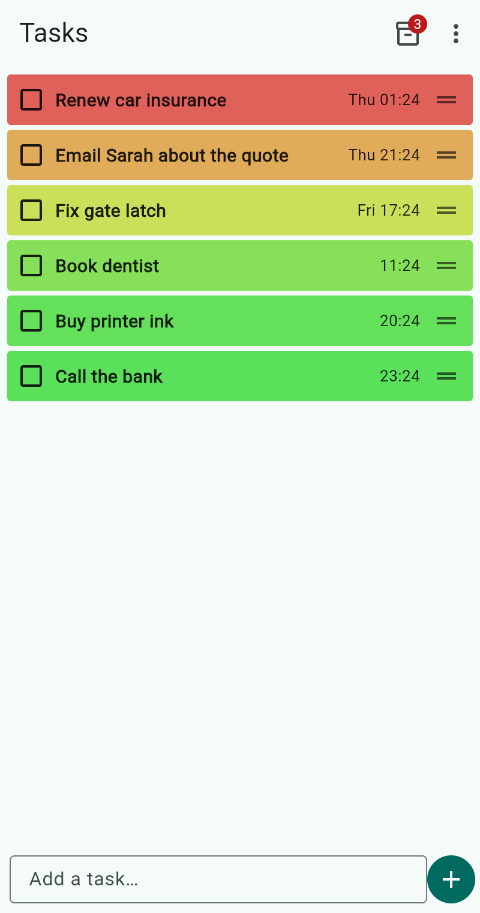
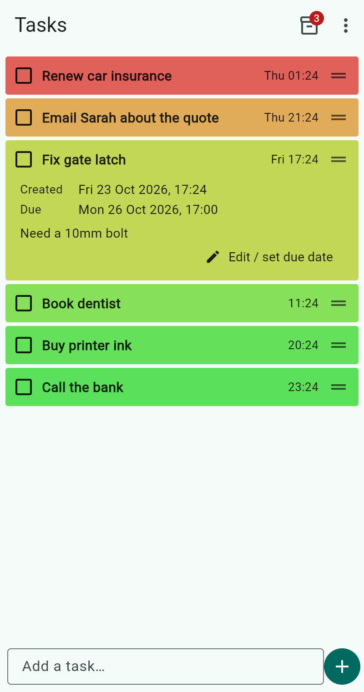
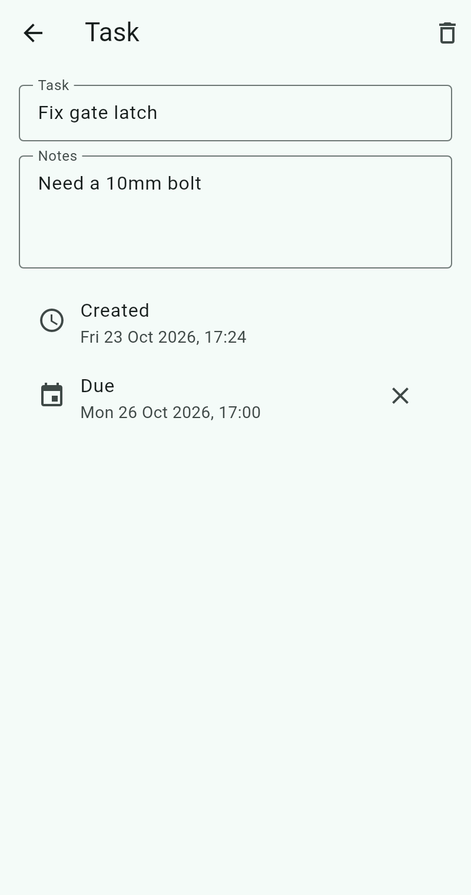
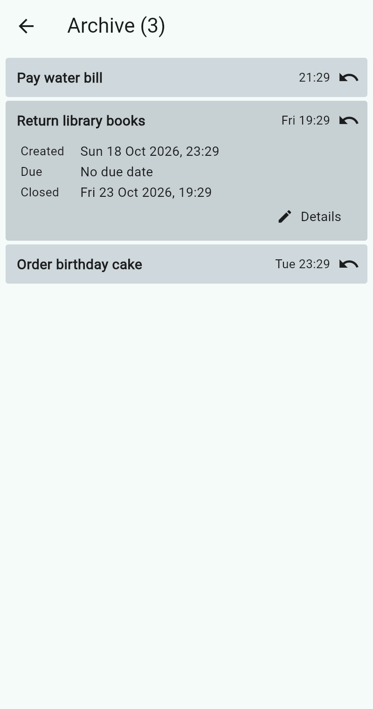
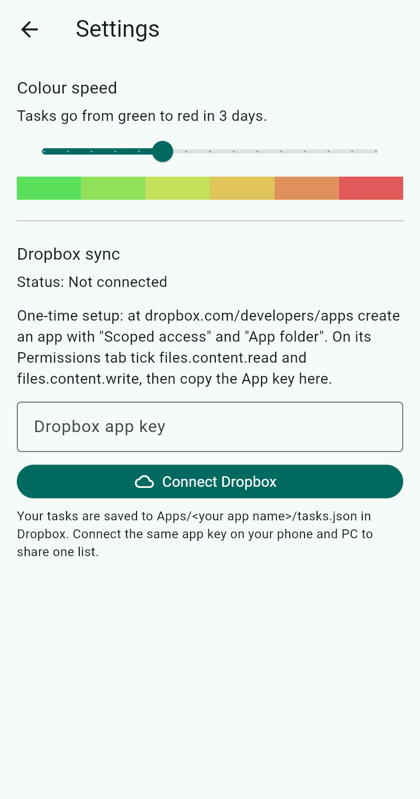
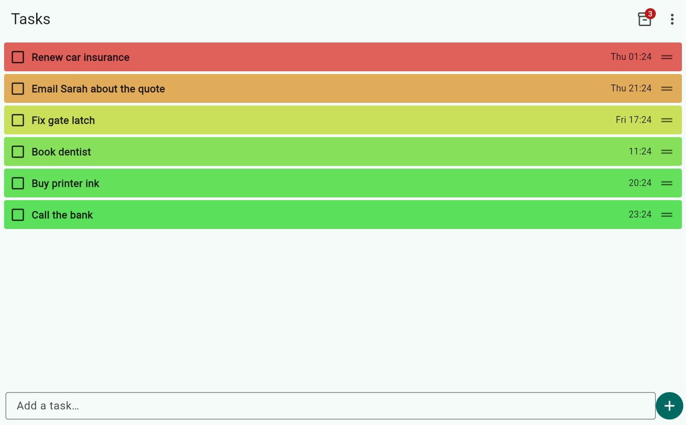

# Task Blocks

A very simple personal task list for Android and Windows (one Flutter codebase).

<p>
  
  
  
</p>
<p>
  
  
</p>

On an unfolded Fold, a tablet or a wide window, the open task sits beside the list:


On a wide screen such as Windows, the blocks stretch across the whole window:



- Type a task at the bottom and press Enter or **+**.
- Each task is a full-width block that starts green and turns red as it ages. Set how fast in **⋮ → Settings → Colour speed**.
- Thin blocks show the name and the time added. Tap a block to expand it and see the created date, due date and notes.
- **Edit / set due date** opens the task to rename it, add notes or set a due date.
- Drag the ≡ handle (or long-press a block) to move it up or down.
- Tick the box to move a task to the **Archive** (box icon, top right), which shows when it was closed. The ↶ button puts it back.
- **⋮ → Export to CSV** saves every task (open and archived) with all details.

## Getting the app

Every push to `main` builds both apps on GitHub Actions. Open the **Actions** tab, pick the latest
"Build apps" run and download:

- **TaskBlocks-android**: unzip and open `app-release.apk` on the phone (allow "install unknown apps").
- **TaskBlocks-windows**: unzip anywhere and run `task_blocks.exe`. Keep the files in that folder together.

## Dropbox sync

1. Go to https://www.dropbox.com/developers/apps and **Create app**: *Scoped access*, *App folder*, any name.
2. On the app's **Permissions** tab tick `files.content.read` and `files.content.write`, then **Submit**.
3. Copy the **App key** from the Settings tab.
4. In Task Blocks open **⋮ → Settings**, paste the key, tap **Connect Dropbox**, approve in the browser and paste the code back.
5. Do the same on the other device with the same key.

The list is stored in `Dropbox/Apps/<app name>/tasks.json`. Each change uploads after 2 seconds; the app downloads
on start and whenever it comes back to the foreground. If both devices change the list while one is offline, the
most recently changed copy wins.

## Building locally

```
flutter test
flutter build apk --release     # Android
flutter build windows --release # Windows (on a Windows PC)
```
