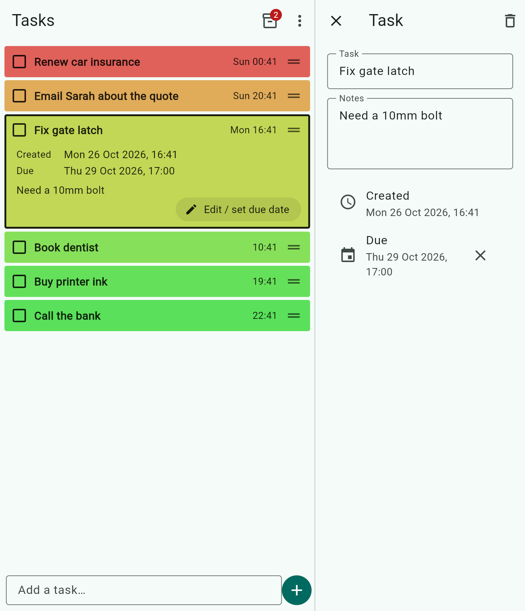

# Improvement plan

Running list of changes from the owner's feedback. Status: ☐ planned · ◐ in progress · ☑ done

## 1. Use the unfolded Samsung Fold screen sensibly ☑ (PR #1, merged 2026-10-28)

**Feedback:** On the Fold's inner screen the single full-width list wastes space.

**Approach (chosen 2026-10-27; PR #1):** when the screen is wide (unfolded Fold, tablet, or a
wide Windows window) switch to two side-by-side panes:

- **Left:** the task list, exactly as now (colour blocks, drag to reorder, tick off).
- **Right:** the task you tapped, opened for editing in place (name, notes, created, due date),
  so there's no jumping to a separate page. With nothing selected, the right pane shows the archive.

Folded (cover screen) looks as it does today; "Edit / set due date" opens the task full screen,
and back/✕ returns to the list. Folding or unfolding keeps the open task. Two panes kick in at
600 dp wide, so the Fold's inner screen gets them in portrait and landscape.

Alternatives considered: a two-column grid of blocks (breaks the "blocks stretch across the
screen" design), or simply larger text/blocks (doesn't use the extra space for anything useful).

## 2. Updates install over the previous version ☑ (PR #1, merged 2026-10-28)

Every CI build used a throwaway debug key, so Android refused to update the installed app.
Release builds are now signed with one permanent key held in the repo's Actions secrets
(`ANDROID_KEYSTORE_BASE64`, `ANDROID_KEYSTORE_PASSWORD`), and each build gets a rising build
number. Without the secrets CI still builds, with a warning. A one-time uninstall is needed
when moving to the new key.

## 3. Safer Dropbox sync ☑ (PR #1, merged 2026-10-28)

Previously the newest whole file won, so edits made on two devices between syncs could be
lost. Now each task carries its own "last changed" time and the two copies are merged task
by task; deletions are remembered for 90 days so they don't come back; list order comes from
whichever device last reordered; settings from whichever last changed them.

## 4. Due date reminders ☑ (PR #1, merged 2026-10-28)

Android shows a notification when an open task reaches its due time (may be a few minutes
late, as Android batches alarms to save battery). Reminders are rebuilt after every change and
sync, so a due date set on the PC reminds you on the phone.

## 5. Swipe gestures ☑ (PR #1, merged 2026-10-28)

Swipe a block right to tick it off, left to delete it. Both show an Undo.

## 6. Colour by due date ☑ (PR #1, merged 2026-10-28)

Settings toggle (on by default): a task with a due date goes green → red between when it was
created and when it's due, instead of at the colour-speed setting.

## 7. Archive search and clean-up ☑ (PR #1, merged 2026-10-28)

Search box in the archive (matches name and notes). Settings → "Delete archived tasks after":
Never (default), 1, 3, 6 or 12 months.

---

# Round 2 ☑ (PR #2, merged 2026-10-28)

## 8. Categories ☑ (PR #2, merged 2026-10-28)

- Each task can be given a category (e.g. Home, Work, Shopping). Categories are created and renamed in Settings.
- **Grouped view** (turned on in Settings): a category heading, then that category's tasks, then the next heading,
  and so on. When it's off, the list looks as it does today.
- Tasks with no category sit in their own group at the top (or bottom).
- Headings are plain bold text (no per-category colours) and can be collapsed to hide their tasks.
- The CSV export gets a Category column.

## 9. Drag between categories ☑ (PR #2, merged 2026-10-28)

- In grouped view, dragging a task under a different heading moves it into that category as well as
  changing its order. Headings can also be dragged to reorder the categories.

## 10. Repeating tasks ☑ (PR #2, merged 2026-10-28)

- In the task, choose a repeat: daily, weekly (pick days), monthly, yearly, or every N days.
- *Proposed:* when a repeating task is ticked off, it goes to the archive as normal and a fresh copy appears
  with the next due date (and its colour starts green again).
- Both modes, chosen per task: **fixed schedule** (next due date counts from the previous due date) or
  **after completion** (counts from when it was ticked off, e.g. "water plants 7 days after last time").

## 11. Text details ☑ (PR #2, merged 2026-10-28)

- Keep the current Notes box. When a task has notes, the thin block shows a short one-line preview
  under the name (blocks without notes stay as thin as now).

## 12. Linked tasks (one after another) ☑ (PR #2, merged 2026-10-28)

- In a task, choose "Comes after…" another task. The later task stays hidden (or shown greyed with a 🔒)
  until the earlier one is ticked off, then appears and starts green.
- Shown greyed out with a 🔒 (so its details can still be edited); it becomes a normal task, starting
  green, when the earlier one is ticked off.

## 13. Focus filter on the main screen ☑ (PR #2, merged 2026-10-28)

- Settings option: show only tasks with no due date or due in the next 30 days (overdue always show);
  tasks due later are tucked away behind a "Later (n)" link.

## 14. Quick dates while typing ☑ (PR #2, merged 2026-10-28)

Typing "Call bank tomorrow 5pm", "Fri", "next week" or "25 Dec" in the add box sets the due date and
strips the words from the name (shown as a hint before you press +).

## 15. Earlier reminders ☑ (PR #2, merged 2026-10-28)

Per task (with a default in Settings): remind at the due time and optionally 1 hour / 1 day / 1 week before.

## 16. Priority star ☑ (PR #2, merged 2026-10-28)

Star a task to keep it at the top of its category/list regardless of colour.

## 17. Snooze ☑ (PR #2, merged 2026-10-28)

Hide a task until a chosen date ("Snooze until…"); it reappears then. Snoozed tasks are listed behind a
"Snoozed (n)" link.

## 18. Home screen widget (Android) ☑ (PR #2, merged 2026-10-28)

The app offers several widgets in Android's widget picker; add any of them, as many times as you like:

- **Task list:** scrolling coloured blocks in list order, with tick boxes (archive without opening the app)
  and a + button that opens straight to typing.
- **Compact:** count of open / overdue tasks and the next 3 due.
- **Quick add:** a single + icon.

When placing a list or compact widget you choose what it shows (all tasks, due soon, or one category),
so e.g. a "Work" widget and a "Home" widget can sit side by side.

## 19. CSV import ☑ (PR #2, merged 2026-10-28)

Import tasks from a CSV in the same format as the export (adds them; doesn't replace the list).

---

# Round 3 ☑ (PR #3, merged 2026-10-28)

## 20. Statistics page ☑ (PR #3, merged 2026-10-28)

A **Statistics** page (from the ⋮ menu) to see how things are going:

- **Done per week**: a bar chart of tasks ticked off over the last 12 weeks, with this week highlighted.
- **On time**: the share of tasks with a due date that were ticked off before it.
- **Typical time to finish**: the median time from adding a task to ticking it off.
- **Open now**: open and overdue counts, and how the open count has moved over the last 30 days.
- **By category**: done and open per category.
- **Streak**: days in a row with at least one task ticked off.
- A period picker: last 7 days, 30 days, 12 months, all time.

Archive clean-up deletes old tasks, so the app keeps a small daily tally (done, on time, by category) that
survives clean-up and syncs through Dropbox. Stats count from when tasks were first archived, so history from
before this update comes from the archive as it is now.

## 21. Tasks from calendar events ☑ (PR #3, merged 2026-10-28)

Look at upcoming calendar events and offer to make tasks from them:

- An **Upcoming events** page (next 14 days) lists events from the calendars you pick; each has **+ Task**,
  which creates a task named after the event, due at its start time (or a set time before, e.g. a day before
  for "prepare for…"). Events already turned into tasks show a tick.
- Nothing pops up unless you choose to. Settings → **Event suggestions**: Off (only when you open the page,
  the default), Once a day, or Once a week. When on, a single dismissible "3 events coming up" line shows at
  the top of the list; events you dismiss or turn into tasks aren't suggested again.
- **Phone only** (agreed 2026-10-28): reads the phone's calendars (Google, Samsung, Outlook accounts added to
  the phone) with permission; nothing leaves the phone. Tasks made from events sync to Windows through Dropbox.

## 22. Calendar view of tasks ☑ (PR #3, merged 2026-10-28)

A month grid (switch from the list with a calendar icon):

- Each day shows coloured dots for tasks due that day (same green→red colours), overdue days marked.
- Tap a day to see its tasks below the grid; tap one to open it. Drag a task onto another day to move its due date.
- Repeating tasks show their future dates faded.
- Undated tasks aren't shown (they stay in the list).
- On the unfolded Fold: month on the left, the chosen day's tasks on the right. A week view as a second option.

## 23. Reusable subtasks (checklists) ☑ (PR #3, merged 2026-10-28)

- Any task can have a **checklist** of steps. Thin blocks show progress like "2/5".
- Tick steps in the expanded block or the task page; reorder by dragging.
- **Reusable**: save a checklist as a **template** (e.g. "Packing for a trip", "Monthly bills") and add it to
  any task in one tap. Templates are managed in Settings.
- Repeating tasks start each repeat with the steps unticked.
- Ticking the last step offers to tick off the whole task.
- Steps have no dates (agreed 2026-10-28). When a step needs one, **Make into task** turns it into a full task
  (which can then have a due date, notes, category and so on). The step stays in the checklist with a link icon,
  opens that task when tapped, and ticks itself when that task is ticked off.
- CSV export lists steps in a column.

## 24. Widget additions (Android) ☑ (PR #3, merged 2026-10-28)

All of these were asked for (2026-10-28).

New widgets, chosen in Android's widget picker like the existing three:

1. **Today:** overdue tasks, tasks due today, and today's calendar events (uses item 21's calendar access).
2. **Focus:** one large block for the top starred task (or the next due), with a tick button.
3. **Checklist:** the steps of one chosen task (item 23), tickable from the home screen.
4. **Stats:** done this week and the current streak (item 20).
5. **Mini month:** a small month calendar with dots on days with tasks due (item 22); tap a day to open it.

Changes to the existing widgets:

6. **More filters:** starred only, overdue only, and a category combined with "due soon".
7. **Look per widget:** light, dark or see-through background; normal or compact rows. Chosen when placing,
   changeable later (long-press → reconfigure).
8. **Snooze button** on each list widget row next to the tick box (snooze until tomorrow 8am; change it in the app).
9. **Quick add into a category:** the quick add widget can be tied to a category (e.g. "Shopping +"), and offers
   voice entry as well as typing.
10. **Fresher colours:** widget colours update more often than every 30 minutes, within Android's battery limits.

## 25. Automatic category for new tasks ☑ (PR #3, merged 2026-10-28)

When a task is added without a category, the app suggests one. It all happens on the device, so there are no
accounts, costs or internet needed:

- **Learns from you:** it looks at the words in tasks you've already put in each category (e.g. "milk",
  "bread" → Shopping) and picks the best match. Every time you move a task to another category, it learns from that.
- **Your own rules:** Settings → Categories → each category can list keywords that always win
  (e.g. "invoice, client, meeting" → Work).
- **Type it:** "#work" or "#shopping" in the task text sets the category directly (and is removed from the title).
- **Where it was added:** a task added from a category's widget, or under a heading in the grouped view, goes into that category.
- The suggestion shows as a chip beside the date chip while you type; tap ✕ to drop it or tap it to choose another.
- Settings → **Auto category:** Off, Suggest (default, shows the chip), or Apply automatically.

## 26. More ways to add tasks ☑ (PR #3, merged 2026-10-28)

These five were picked (2026-10-28):

1. **Share to Task Blocks** (Android): appears in the share sheet of any app. Shared text becomes the title
   (first line) and notes; a shared link goes into the notes. Opens a small add box with the date and category chips.
2. **Paste a list** (both): pasting several lines into the add box offers "Add 6 tasks?", one per line,
   each with its own quick date and category. Bullet marks and numbering are removed.
3. **"Hey Google, add a task…"** (Android): voice entry through Google Assistant, so it works without opening the app.
4. **Photo of a list** (Android): take or pick a photo of a handwritten list or whiteboard. On-device text
   recognition reads it (nothing uploaded), then shows the lines with ticks to choose which become tasks.
5. **Dropbox inbox** (both): any line written to /inbox.txt in the app's Dropbox folder becomes a task on the
   next sync, then the file is cleared. Works with email-to-Dropbox, IFTTT, Zapier and similar services.

Not wanted: missed calls, Windows shortcut key. Notification suggestions: see item 28 (placeholder only).

## 27. Overdue notifications ☑ (PR #3, merged 2026-10-28)

Today the phone gives one reminder at the due time (and an optional earlier one). New option,
Settings → **Overdue reminders**:

- **Off** (as now).
- **Daily summary** at a time you choose (e.g. 8am): "3 tasks overdue: Pay council tax, …". Tap to open the list.
- **Keep nudging**: a reminder for each overdue task every 1, 3 or 6 hours (your choice) until it's done or snoozed.
- **Quiet hours** (e.g. 10pm–7am) when no overdue reminders are sent.
- All task reminders gain **Done** and **Snooze** buttons (1 hour, this evening, tomorrow) so you can deal with
  them from the notification without opening the app.

## 28. Notification suggestions: settings placeholder only ☑ (PR #3, merged 2026-10-28)

To be considered later (2026-10-28). Round 3 adds only the **settings, greyed out and marked
"Coming later"**, with no notification access and no listener code:

- Settings → **Suggestions from notifications**: an on/off switch (disabled).
- **Apps to watch**: a list (disabled).
- **Look for**: dates and times, and words like "appointment, due, deliver, renew, pay" (disabled, editable list shown).
- **Where suggestions go**: the same Suggestions list as calendar events.

If it's built later: Android "Notification access", only from the chosen apps, suggestions only (never added on
their own), everything stays on the phone.

## 29. Clean-up and speed review ☑ (PR #3, merged 2026-10-28)

A final review was asked for before round 3 was built. Done in the same PR:

- **Saving is debounced**: typing in a task used to rewrite the whole file, reschedule every reminder
  and redraw the widgets on every key. Now the screen updates at once and the rest happens 0.4 s
  after you stop typing (and straight away when the app goes to the background).
- **Safer saves**: the file is written to a temporary name and renamed, so a crash mid-write can't
  corrupt the list.
- **Lighter redraws**: the add box is its own widget, so typing no longer rebuilds the whole list.
- **Fewer syncs**: coming back to the app syncs at most once every 30 s.
- **Widgets** parse the shared data once per redraw instead of once per row.
- **CI** now runs `flutter analyze` as well as the tests, and caches the Flutter SDK.
- Removed template leftovers (unused cupertino_icons, TODO comments in Gradle); app version 1.3.0.

# Round 4 ☑

Feedback on round 3 (2026-10-28). Items 31 and 32 are bugs; items from 30 on are the feature list,
to be agreed before building.

## 30. Where tasks came from, in Statistics ☑ (PR #10, merged 2026-11-01)

**Feedback:** "Would be good to show where a task was created from in statistics."

Each task remembers how it was added: typed in the app, home screen widget, voice (widget microphone or
"Hey Google"), shared from another app, pasted list, photo of a list, Dropbox inbox file, calendar event,
CSV import, a repeat of an earlier task, or a checklist step made into a task. Statistics gets a
**By source** section: added and done per source for the chosen period, and the share that got done.
The daily tally that survives archive clean-up records the source too, and it syncs through Dropbox.
Tasks from before this update show as "Unknown".

Built: a **By source** table (added in the period, the share of those now done, and ticked off in the period).
No separate tally was needed: completion records now keep the source, and tasks deleted by the archive
clean-up are counted from those records.

## 31. Reminder and category text squashed in the right-hand pane ☑ (PR #4, merged 2026-10-29)

**Feedback:** on the unfolded screen the task pane shows the reminder text vertically, one letter per line.

The "Remind me" and "Category" drop-downs sat at the right edge of their rows; in the narrower right pane
they were squeezed until the text wrapped letter by letter. They now sit under the row's title and take the
full width, with long names cut with "…" instead of wrapping.

## 32. Widget blank for a while after folding ☑ (PR #4, merged 2026-10-29)

**Feedback:** after folding the phone the widget disappears, then comes back after a while.

When the launcher resizes a widget (folding changes the grid) it asks the app to redraw; the widgets did
nothing on that request, so the list stayed empty until the next scheduled refresh (up to 15 minutes).
Each widget now redraws itself straight away when its size changes. If this still leaves a gap of a few
seconds, that is the phone restarting the app's widget service and can't be avoided.

## 33. Place-based reminders ☑ (PR #11, merged 2026-11-01; needs a real-phone check)

**Feedback (2026-10-29):** "GPS based notification: arrived home on the day of the task, push a notification."

Android geofencing (phone only). **Places** in Settings, saved from the current location with a name and
radius (default 150 m); coordinates stay on the phone, only the name travels with a task. A task gets an
optional "Remind me when I arrive at / leave …"; with a due date it fires on arrival that day and while
overdue, without one on the next arrival. A general opt-in: "When I arrive at a place, show that day's
tasks" as one notification. Needs location "Allow all the time" and the app set to unrestricted battery on
Samsung (one-time setup card). Accuracy about 100 to 200 m, alerts can be a few minutes late.

Built: Settings → **Places** (Android): "Save where I am" with a name; tap a place to rename it, change the
radius (100 m to 1 km) or delete it. Renaming a place moves its tasks to the new name. The task page has
**Place reminder**: "When I arrive at …" or "When I leave …". The setup card shows until location is "Allow all
the time" and the battery is unrestricted. Android's geofencing watches the places (re-registered after a
reboot or update); on a crossing, `PlaceReceiver.kt` reads the saved `tasks.json` and notifies, at most once a
day per task (once in all for tasks without a date), skipping snoozed tasks. The opt-in summary lists what is
due today or overdue, once per place per day.

## 34. Label an email to make a task ☑ (folded into item 54, version 1.7.1)

**Feedback (2026-10-29):** "Could Google emails on my phone turn into tasks?"

Today: select text in Gmail, Share, Task Blocks. To build: Task Blocks signs in to Google once (OAuth, like
Dropbox); on each sync it picks up emails carrying a chosen label (default "Task") or star, makes a task from
the subject with sender and date in the notes and a link that opens the email in Gmail, then swaps the label
to "Tasked". Phone and Windows. The owner creates a Google Cloud OAuth client (steps to be written); Google shows a
one-time "unverified app" screen. Source "Email" in statistics (item 30).

## 35. Skip a repeating task ☑ (PR #9, merged 2026-11-01)

**Feedback (2026-10-30):** one tap to move a repeating task to its next date without marking it complete.

A "Skip" button in the expanded block, on the task page and on the reminder notification of a repeating
task. Moves the due date to the next occurrence (from today for "after done" repeats), unticks the
checklist, keeps the same task, and records the skip for item 36. Snooze is unchanged.

Built: the Android reminder of a repeating task shows Done, Skip, 1 hour (Android shows three buttons); on the
iPad, Done, Skip, 1 hour, Tomorrow. Skips sync and each task in a repeating series now carries the series id.

## 36. Repeats and timing in Statistics ☑ (PR #10, merged 2026-11-01)

**Feedback (2026-10-30):** how often repeating tasks get done or not, and how early or late tasks are done.

- **Repeating tasks**: one row per series with done, skipped and missed counts (missed = a whole cycle passed
  without a tick) and the share done, for the chosen period.
- **Early or late**: for tasks with a due date, the median amount before or after the due date, the split
  early / same day / late, and buckets (over a week early, 1 to 7 days early, same day, 1 to 7 days late,
  over a week late). Done records gain the signed amount and a series id; older records only count in the
  split.

Built: completion records keep the series, the signed minutes after the due time, and how many whole cycles
went by unticked (fixed schedules only: a tick or skip after a later repeat date counts the dates passed as
missed; an open overdue repeat counts its passed dates too). Shown as a **Repeating tasks** table and an
**Early or late** section with the typical lateness, the split and the five buckets by calendar day.

## 37. Weekday choice for every-N-weeks repeats ☑ (PR #5, merged 2026-10-30)

**Feedback (2026-10-30):** "If I select repeat as every 2 weeks it doesn't give a choice of the day of the week."

The day chips were only offered for "every 1 week". They now show for any number of weeks: the next date is a
later chosen day in the same week, else the first chosen day of the week N weeks on. Shown as "Every 2 weeks
on Mon, Thu".

## 38. Added-by-date and added-vs-done charts ☑ (PR #10, merged 2026-11-01)

**Feedback (2026-10-30):** a graph of tasks added by date, and added vs done with a line for total
outstanding, with the option to show by category.

Two charts on the Statistics page for the chosen period: **Added per day/week** (bars), and **Added vs done**
(paired bars) with a line for how many were open at the end of each day/week. A category chip row filters
both (All, or one category). The daily tally records added counts per category so the charts survive archive
clean-up; history before this update comes from the created dates of tasks still in the list or archive.

Built: one bar per day for periods up to a month, per week up to a year, per month beyond; the open line has
its own scale, labelled at its peak. Category chips: All, each category, No category.

## 39. Mac build ☑ (PR #6, merged 2026-10-30; text fix PR #7)

**Feedback (2026-10-30):** "Can I run the app on Mac?"

A macOS target and a third CI job that attaches **TaskBlocks-macos** (a zipped app) to every build. The Mac
gets everything Windows has: list, two-pane layout, categories, statistics, calendar view, checklists,
CSV, Dropbox sync, pasted lists. Phone-only features stay phone-only: widgets, reminders, calendar event
suggestions, photo text, share-to-app, voice, and the place reminders of item 33. The app is not signed with
an Apple developer certificate, so the first launch needs System Settings → Privacy & Security → "Open
Anyway" (or `xattr -cr "Task Blocks.app"` in Terminal).

**Follow-up (2026-10-31, PR #7):** text inside an expanded block came out garbled on the Mac (letters replaced
by broken pixels). That is Flutter's Impeller renderer on macOS mishandling glyphs inside an animated,
clipped region; the Mac app now draws with Skia (`FLTEnableImpeller` off), as the Windows build does.

---

# Sources, location and iPad (2026-11-01)

**Feedback (2026-11-01):** "Add a task source for each task added — if we pull from the calendar it could say
calendar, otherwise manual — which will allow me to later have other pushes to the app. Also plan how some
other tool could push to the app. A setting so the calendar look-ahead can be more than 7 days. Collect GPS
when we create or complete a task for later geofencing. And an iPad version."

## 47. Where each task came from ☑ (PR #8, merged 2026-11-01)

Every new task records its source: typed in the app, home screen widget, voice (widget microphone or "Hey
Google"), shared from another app, pasted list, photo of a list, Dropbox inbox, calendar, CSV import, a repeat
of an earlier task, or a checklist step. Shown on the task page under Created, and as a Source column in the
CSV export (read back on import). It is a plain name, so outside tools can push tasks with their own source
later (see item 48). Older tasks made from a calendar event count as Calendar; other older tasks are Unknown.
Item 30 (By source in Statistics) builds on this.

## 48. Plan: other tools pushing tasks in ☑ (A built in 1.7.1, B in 1.8.5; design in docs/PUSH_TASKS.md)

Recommended: a Dropbox `inbox/` folder that takes one small JSON file per task (title, due, notes, category,
source, the tool's own id to avoid duplicates), then an Android "add task" intent for Tasker-style apps, and a
small web endpoint only if a tool can only call webhooks. Open questions for the owner are at the end of the doc.

## 49. Calendar look-ahead setting ☑ (PR #8, merged 2026-11-01)

Settings → Calendar events → **Look ahead**: 1 week, 2 weeks (the old fixed value and the default), 1, 2, 3 or
6 months, or 1 year. Used by Upcoming events and the suggestion line at the top of the list. Syncs.

## 50. Record location when adding and ticking off ☑ (PR #8, merged 2026-11-01)

Settings → Location → **Record where tasks are added and done** (off until switched on; turning it on asks for
location access, "while using the app" only). Each task keeps the place and accuracy when it was added and
when it was ticked off; the task page shows a pin that opens it in Maps. Phone and iPad only. Ticks made on a
widget or notification while the app was closed get no location (the app would only know where you are
later). Synced with the tasks, ready for place-based reminders (item 33).

## 51. iPad version ☑ (PR #8, merged 2026-11-01; details in docs/IPAD.md)

An iOS target that runs on iPad (and iPhone) with the two-pane layout, reminders with Done/snooze buttons, and
location recording. CI attaches an unsigned **TaskBlocks-ios** build; installing it needs the owner's Apple ID
(free, re-sent every 7 days) or a paid developer account (a year, TestFlight). Widgets, calendar suggestions,
photo text, share and voice stay Android-only for now.

---

# Round 4, everyday list (planned 2026-10-30, built in round 4 PR 1)

Full round 4 plan: four PRs. PR 1 = items 35, 40, 41, 42, 43, 45. PR 2 = 30, 36, 38, 44. PR 3 = 33, 46.
PR 4 = 52 Kanban board. Item 34 moved to a later phase 5 (2026-11-01). Version 1.4.0.

## 40. About and What's new ☑ (PR #9, merged 2026-11-01)

Settings → **About Task Blocks**: version and build number, a changelog for every version (1.0 to 1.4), and a
link to the GitHub project. After an update (not a fresh install) a one-time **What's new** pop-up lists that
version's changes. The changelog lives in `lib/changelog.dart`; add the new version there with each bump.

## 41. Search the main list ☑ (PR #9, merged 2026-11-01)

A magnifying glass in the top bar opens a search box. Every word typed must appear in a task's name, notes or
checklist (any case). It looks through every open task, snoozed ones too, whatever quick filter is picked.

## 42. Sorting and quick filters ☑ (PR #9, merged 2026-11-01)

**Feedback (2026-10-31):** "A few more sorting options in settings. Sorting by due date with stars at the top
by default. Maybe a quick button at the top to just show due next 2 weeks etc."

- Settings → List → **Sort by**: hand-made order (drag), due date (no date last), colour age (reddest first),
  newest first, or category then due date. **Starred at the top** works with any sort. A fresh install sorts
  by due date with starred at the top; existing lists keep hand-made order until changed. Drag handles show in
  hand-made order only. Group by category still works and sorts inside each group. Synced.
- **Quick filter chips** above the list: All, Today, Next 7 days, Next 2 weeks, Next 30 days, Overdue,
  Starred, No date. Date chips show tasks due by the end of that day, overdue ones included, and leave out
  tasks with no date. Each device remembers its chip. A line under the list says how many tasks the chip
  hides, with a Show all button. Settings switch to hide the row. The old "only show the next 30 days"
  setting is replaced: a device that had it on starts on the Next 30 days chip.
- Widgets keep their own filters.

## 43. Tappable links in notes ☑ (PR #9, merged 2026-11-01)

Web links (http, https, www.), email addresses and phone numbers in notes are underlined in an expanded block
and open the browser, mail or phone app when tapped. On the task page they show as chips under the notes box.
Dates like 2026-11-01 are not taken for phone numbers.

## 44. Weekly review notification ☑ (PR #10, merged 2026-11-01)

Off by default; pick the day and time (default Sunday 6 pm). Last week's added and done counts, what is
overdue and what is due in the coming week. Tapping it opens the list on Next 7 days.

Built: Settings → Reminders → **Weekly review** (synced), phone and iPad. The numbers are worked out when the
reminder is scheduled, which happens whenever the app changes anything, so they are as of the last use.

## 45. Time estimates ☑ (PR #9, merged 2026-11-01)

Task page → **Time needed**: 15 min, 30 min, 1 h, 2 h, 4 h, 8 h, or Other (e.g. 45, 1.5h, 1h30). Shown on the
block ("1h30") and in its details; a line above the list gives the total for the tasks shown. Copied to the
next repeat. CSV gains an "Estimate (min)" column, read back on import.

## 46. Backups and restore ☑ (PR #11, merged 2026-11-01)

A daily backup of all tasks, the archive and settings, kept for 7 days. Settings → Backups lists them by
date and restores one after asking. Save a backup file or open one by hand, e.g. for a new device.

Built: Settings → **Backups**, all platforms. One file a day in the app's own folder (`backups/`), older than 7
days deleted. Restoring keeps the current data as a "before a restore" backup first, then replaces everything;
restored tasks count as just edited and tasks not in the backup count as deleted, so the restore wins on every
synced device. "Save a backup file" and "Open a backup file" use the same format.

## 52. Kanban board ☑ (PR #12, merged 2026-11-02)

**Request (2026-11-01):** a Kanban option, with each move between stages recorded (from, to, when, where).
Stages chosen: Backlog, Up next, In progress, Blocked, Done. Plan: Claude doc "Kanban board plan (item 52)".

Built:
- **Kanban board** in the main menu (and a board icon in the top bar once anything is on it). Wide screens
  (unfolded Fold, tablet, desktop) show the columns side by side: drag a card (press and hold on a touch screen),
  or on a touch screen swipe it right / left for the next / previous stage. Narrow screens show one column at a time with
  tabs and counts; each card has an arrow to the next stage, since a sideways swipe there changes column.
  Every card's ⋮ has Move to… (any stage, optional note), Open task, Tick off, Take off the board.
- The + on a column adds a task straight into that stage (source "Kanban board").
- Cards: name, star, category, due, checklist progress, estimate, "In progress for 3 days", and the same
  green-to-red colour as the main list. The board has its own search, quick filters and a category chip.
- Task page: **On the Kanban board** switch (off keeps the history; on again returns to the last stage),
  a Stage picker, and **Board history** (newest first: from → to, when, time in the previous stage, how,
  device, note, and a map button when a location was recorded).
- Main list: board tasks show a small stage label; the expanded block has **Add to board**. Settings,
  Kanban board can hide them from the main list instead. (The plan's swipe / long-press "Add to board" on
  the main list was left out: swipes there already tick off and delete, and long press drags.)
- Settings → **Kanban board**: rename, reorder, add and remove stages (removing one asks where its tasks
  go, recorded as a move), a colour and an optional limit per stage (heading turns amber above it), and
  what moving to the last stage does: ask, tick off, or keep open.
- Ticking off a board task from anywhere records a move to the last stage; restoring it from the archive
  records a move back. A repeating board task's next copy starts again in the first stage.
- Data: `Task.kanban`, `stageId`, `moves` (`StageMove`: from/to id and name as at the time, at, how, where,
  device, note); `AppData.stages`, `kanbanDone`, `kanbanHideFromList` (synced settings). Sync joins both
  devices' moves by id and takes the stage from the latest move. `DoneRecord` keeps minutes per stage.
- Statistics: Kanban card with average and typical time in each stage, moves a week, tasks moved
  backwards, and the tasks longest in their stage. CSV: Stage column, and a second file kanban_moves.csv
  (one row per move) when exporting.

---

# Round 5 (planned 2026-11-02)

Plan: Claude doc "Task Blocks round 5 plan". New: 53 Google sign-in, 54 tasks from emails sent by allowed
addresses (replaces 34), 55 starred emails page, 56 Kanban steps, 58 a calendar event as a step, 59 views for
the unfolded right-hand panel, 60 urgent / important matrix (Do, Decide, Delegate, Delete), 61 step details and
Split out, 62 older copies keep newer data, 63 export of the new fields, 64 quick-add words, 65 deep search,
66 neutral app ids, 67 categories that go on the board by default, 68 Kanban and Matrix widgets. Carried over:
48 (pushing tasks in). 28 (notification suggestions) and the iPad extras are left out this round. 56 was asked
for first (2026-11-02).

Build order (planned 2026-11-03): 1) 62 + iPad/Mac part of 66, 2) 53 + 55, 3) 48A + 54, 4) 60 + 64 + 65 + 67,
5) 61 + 58, 6) 59, 7) 68 + 48B + Android part of 66. 63 goes into each PR for the fields it adds.

## 56. Checklist steps on the Kanban board ☑ (PR #13, merged 2026-11-02)

**Request (2026-11-02):** "have the sub tasks show on the kanban and be moved separately to the main tasks but
maybe clearly in a stream so they are easily seen as linked to the task", without cluttering the board.

Built:
- Task page, under On the Kanban board: **Steps on the board too** (off by default). Turning it on puts each
  checklist step on the board: ticked steps in the last stage, the rest where they were before or in the first.
- Steps start **folded** into a chip on the task's card ("5 steps: 1 under way, 1 done"). Tap it to unfold that
  task; the top bar's **Show all steps** unfolds every task (remembered on the device).
- Step cards are smaller, tinted and edged in the task's colour, with "step 2 of 5" and how long they have
  been in their stage. On a wide screen they sit under their task's card when in the same column; in other
  columns a task's steps sit together at the top under "Task name · 2 steps here". On a narrow screen an
  unfolded task shows all its steps under it, with each step's stage.
- **Lanes** (wide screens, top bar): one row per task with steps on the board, the task and its steps across
  the stages; the other tasks share a row at the bottom. Remembered on the device.
- Steps move like tasks: drag, swipe on touch screens, the arrow on narrow screens, or tap, Move to… (with a
  note). Moving into the last stage ticks a step and moving out unticks it; ticking one in the checklist moves
  it to the last stage and unticking moves it back. When a step finishes the checklist the app offers to move
  the task on.
- Moving the task itself never moves its steps. Moving it to the last stage with steps still open asks: tick
  them all, leave them, or cancel. Taking the task off the board takes its steps off too (recorded); putting it
  back returns them to their stages.
- Skip and the next repeat start the steps again in the first stage. Removing a stage moves its steps with its
  tasks. A step made into its own task shows "Step of …" on that task's card.
- Data: `Task.stepsOnBoard`; `TaskStep.stageId` and `moves` (same `StageMove` records as tasks). Sync joins
  both devices' step moves by id, like task moves.
- Task page: each board step shows its stage in the checklist, and **Steps' board history** lists every step
  move. Statistics: a separate table of time in each stage for steps and step moves a week (task numbers are
  unchanged). kanban_moves.csv gains a Step column with a row per step move.

## 57. Drag to reorder works in any sort ☑ (version 1.6.1)

**Feedback (2026-11-02):** "Dragging tasks up and down seems to have stopped working on android."

Cause: since item 42 (PR #9, 1.4.0) the drag handles only showed with Sort by set to hand-made order, and a
fresh install sorts by due date, so the list had no handles and long press did nothing.

Fixed:
- Drag handles and long press to drag show whatever the sort (not while searching). Dropping a task in a
  sorted list switches Sort by to hand-made order, keeping the order that was on screen plus the move, with
  Undo to put the old sort and order back.
- With "Starred at the top" on, dropping a task where the star rule will move it back shows a short note.

## 62. Older copies keep newer data ☑ (version 1.6.2)

Round 5 adds new things to the synced tasks.json. A device still on an older version used to drop any field it
didn't know when it saved, and that loss then synced to every device.

- Every task, step, category, stage, checklist template, board move, completion record and the file itself keep
  any fields they don't recognise and write them back unchanged. When two copies are merged, unknown top-level
  fields from both are kept (the newer copy wins on the same field); a task's come with whichever copy wins.
- The file records the newest app version that saved it (`newestApp`). A device older than that shows a note at
  the top of the list: "Another device has a newer Task Blocks (x.y.z). Please update this one."
- Before an older device uploads over a Dropbox file written by a newer version, it keeps a copy in the
  `/backups` folder of the app's Dropbox folder (five slots, one per day in turn).
- This has to reach every device before any round 5 field appears, so it ships first and on its own.

## 66. Neutral app ids ☑ (iPad and Mac in 1.6.2; Android code names in 1.8.5)

- iPad and Mac bundle id is now `app.taskblocks`. They install as a new app once: connect Dropbox again, let it
  sync, then delete the old copy (see docs/IPAD.md).
- Android keeps its application id, because changing it would install a second app instead of updating. The
  Android code package, the channel name and the widget class names move to a neutral name in the widgets PR
  (item 68), after which home screen widgets need adding again once.
- Done in 1.8.5: the Kotlin package, Gradle namespace, method channel (`app.taskblocks/native`), place
  reminder action and widget classes are all under `app.taskblocks`. Only the `applicationId` line in
  android/app/build.gradle.kts keeps the old id, so the update installs over the existing app.

## 53. Google sign-in ☑ (version 1.7.0; setup in docs/GOOGLE.md)

- Settings → Google: client ID and secret of the owner's own "Desktop app" OAuth client, Sign in / Sign out,
  the signed-in address. Phone, Windows and Mac; iPad later.
- Installed-app flow with PKCE and a one-off page on 127.0.0.1; scope `gmail.modify` (read, labels and stars;
  no send or delete). Refresh token and client details are device-only (device_settings.json), never synced.
- A refused refresh token ("invalid_grant") signs the device out and Settings offers Sign in again.

## 55. Starred emails page ☑ (version 1.7.0)

- Menu → Starred emails: starred Gmail emails, newest first, look-back 1 week / 1 month (default) / 3 months / all.
- Each: Make task (subject read for dates and #category; source "Starred email"), Attach to task (picker with
  search, starred and board tasks first), Hide (synced; "Show hidden emails" in the menu). Used ones show
  "Task: ..." or "Attached to: ...".
- Tasks keep `emails` (Gmail id, thread id, subject, From, date, a snippet of at most 300 characters). Task page
  Emails section with Open in Gmail and Remove; envelope on the block.
- After use: keep the star (default), remove it, or remove it and add the "Tasked" label.
- Optional line at the top of the list, "N starred emails not yet tasks" (off by default; checked on open and
  resume, at most every 10 minutes).

## 63. Export carries the new fields ◐ (emails in 1.7.0, matrix in 1.8.0; the rest with each feature)

- Tasks CSV gains Matrix box and Waiting on columns (1.8.0); import reads the box by its name here or its
  standard name.
- Tasks CSV gains an Emails column (count). `task_emails_<date>.csv`: one row per email kept on a task; importing
  it puts the emails back on their tasks (matched by name and created time), skipping ones already there.

## 48A. Dropbox inbox folder and sourceRef ☑ (version 1.7.1; design in docs/PUSH_TASKS.md)

- Each `.json` file in `Apps/<app>/inbox/` (one task or a list) becomes tasks on sync: title, notes, due (plain
  date = 9am), category (made if missing), starred, steps, source, ref, url. Files are checked whole first, so a
  bad entry adds nothing; added files are deleted, unreadable ones go to `inbox/failed/`.
- `Task.sourceRef` keeps the tool's id; a known `source` + `ref` is skipped, and two devices that both added it
  before syncing are merged to the first.
- Needs `files.metadata.read` on the Dropbox app; without it Settings says so and sync carries on.
- Settings → Dropbox describes the folder and copies an example file.

## 54. Tasks from emails, only from addresses you allow ☑ (version 1.7.1; replaces 34)

- Settings → Google → Email to tasks (off by default) and Allowed senders (exact addresses; `@domain` only when
  written so). Synced.
- Trigger (decided 2026-11-03): allowed sender **and** subject starting with "Task", or the Gmail label "Task".
  Gmail's SPF or DKIM must pass for the sender's domain (emails sent from the signed-in account count as
  checked).
- Task: subject without "Task", read for dates and #category; source Email; the email in its Emails section;
  `sourceRef` = Gmail id. Gmail label swaps to "Tasked".
- Checked on open, resume (without Dropbox) and every sync, at most every 2 minutes, last 14 days.
- Settings lists the emails ignored this week and why, with Allow this sender.

## 60. Urgent / important matrix ☑ (version 1.8.0)

- Opt in per task: task page → On the matrix, then a box. Boxes are Do, Decide, Delegate and Delete (renamable in
  Settings → Matrix). `Task.matrixBox` (JSON `box`), copied to the next repeat.
- Decide asks for a due date when there is none. Delegate asks who it is waiting on (`Task.waitingOn`, JSON
  `waiting`). Delete offers to just file it, tick it off or delete it.
- Menu → Matrix: a 2 by 2 grid with drag between boxes (long-press), a menu on each card, search, and the same
  category and date filters as the Kanban page, remembered on each device. Box counts follow the filter.
- Optional "Urgent?" hint (Settings → Matrix, off by default): a task in a not-urgent box due within the days
  set.
- The task block shows its box; the expanded block shows the box and Waiting on.

## 64. Quick-add ! words ☑ (version 1.8.0)

- `!do`, `!decide`, `!delegate`, `!delete` put a new task in that box, `!board` on the Kanban board, `!star` stars
  it. They work in the add box, Paste a list and emails to tasks. Unknown `!words` stay in the name.
- Settings → Quick-add words lists everything the add box reads (#category, dates, ! words). Each ! word can be
  renamed or switched off (`AppData.quickWords`; '' is off). Box words follow a renamed box unless set by hand.

## 65. Deep search ☑ (version 1.8.0)

- The list search now also looks in the category, Waiting on, place and the emails kept on a task, ignores accents,
  and keeps "quoted words" together.
- Menu → Search everything (or the icon while searching): results grouped as Tasks, Steps, Emails and Archive,
  with the matching words highlighted. Filters: category, open, done, starred, has a date, on the board, on the
  matrix. All on the device.

## 67. Categories that go on the board ☑ (version 1.8.0)

- Settings → Categories → a category → New tasks go on the board, with the stage to start in and Steps on the
  board too. Applies when a task is added in that category or moved into it; it never takes a task off.
- Turning it on offers to put the category's open tasks on the board now.

## 69. Device settings backup ☑ (version 1.8.1)

- Most settings already sync in tasks.json. The ones kept on each device (places, list and board view choices,
  location recording, the Google client ID and secret) are saved on each sync, when they changed, to
  `Apps/<app>/devices/<kind>.json` (android, iphone-or-ipad, mac, windows). Sign-ins are never copied.
- After connecting Dropbox, the first sync looks for this kind of device's file. If it holds something different,
  a line at the top of the list offers Restore or Not now; nothing is saved over it until answered.
- Settings → Dropbox → Restore settings from a device lists every device's file, newest first, so an iPad can
  take the Mac's Google client too. A Google client already on the device is never replaced.

## 71. Battery and speed review ☑ (version 1.8.2)

Review of the whole app (2026-11-03) for battery use, speed and general bugs. Fixed:

- Reminders: every save cancelled and re-set every notification (up to a few hundred system calls). Now skipped
  unless something a reminder depends on changed, and at least once a day.
- Widgets: every save redrew all eight widgets. Now only when the data they show changed.
- Email to tasks: each check (every sync, at most every 2 minutes) downloaded every matching email from the last
  14 days again, including ones already found not to be tasks, and listed the Gmail labels twice. These are now
  remembered while the app runs.
- The minute tick that re-colours the list kept running in the background; now only while on screen.
- Two saves at the same moment (a sync and an edit) shared one temporary file, so one could fail. Saves now
  take turns.

Looked at and fine: place reminders use Android geofencing (no constant GPS), location is only read when adding or
ticking off (a recent fix is reused), widget refresh is one 15-minute job only while a widget exists, reminders
use inexact alarms, and edits are batched (0.4 s save, 2 s upload). Each sync is still about four small Dropbox
calls; checking the file's revision first would save one download but needs the files.metadata.read permission,
so it is left for now.

## 61. Step dates, notes and Split out ☑ (version 1.8.3)

- Tap a step: give it a date and reminder, add a note. `TaskStep.dueAt` (`due`), `remindBefore` (`remind`),
  `note`. Dated steps show in the calendar on their day ("Step of <task>") and get their own reminder with the
  task's name (no Done or Snooze buttons, as those act on whole tasks). A repeat moves step dates along with the
  task's due date.
- **Split out into a task of its own**: the step leaves the checklist and becomes a task placed after its task.
  It takes the task's category, star, place, estimate, matrix box and Waiting on; the step's date and reminder,
  or the task's when the step has none; its own stage and board history when steps are on the board, otherwise
  the task's stage. Not the repeat, checklist or notes (the step's note becomes its notes). `Task.splitFrom`
  links back ("Split from" on the task page). A step already made into a linked task frees that task instead.
  Undo puts it back. "Make into a linked task" stays as it was.

## 58. Calendar event as a step ☑ (version 1.8.3)

- Upcoming events: the list icon adds the event as a step of an open task (with search): "Suit fitting (Sat 14
  Nov, 10:30)", dated at the event (all-day: 9am) so it is reminded and shows in the calendar, with the location
  as its note. `TaskStep.eventId` (`event`) stops it being offered again.
- Question 9 asked for a linked task to keep the date and reminder; with step dates (61) the step keeps them
  itself, without an extra task in the list.

## 70. Email to tasks while the app is open ☑ (version 1.8.3)

- Settings → Google → Email to tasks → Also check while the app is open: off (default), every 30 minutes, hour or
  2 hours. Device-only (saved with the device backup, item 69). Runs only while the app is on screen: a sync with
  Dropbox, otherwise just the Gmail check. Opening or coming back to the app already checks.
- A background check with the app closed was dropped: checking on opening is enough.

## 59. Right-hand panel views ☑ (version 1.8.4)

- On a wide screen with no task open, the right-hand side has a chip row: Agenda (default), Matrix, Board,
  Calendar, Events (phones and tablets), Statistics and Archive. Opening a task and closing it comes back to the
  chosen view.
- Agenda: Overdue, Today, Tomorrow, then each day up to a week, with dated steps ("Step of …"); tick boxes tick off
  the task or step. Snoozed tasks are left out.
- Matrix: the full matrix page at half the screen (the list and panel split 50/50), so the 2 by 2 grid fits on the
  Fold's ~700 dp inner screen. Board: a mini board, one row per stage with its count (red when over the limit),
  tapping unfolds its tasks; + puts a task in that stage. (The plan had dragging from the list; the list's long
  press already reorders, so + is used instead.) Statistics: the parts picked in Settings, stacked, plus All
  statistics.
- Settings → Right-hand panel (device-only, saved with the device backup): starts on, or reopen the last view;
  views to offer; Statistics view shows (this week, added and done in 7 days, by category, by source, time in each
  stage); When I unfold the phone, open (the list and panel, the whole board, the whole matrix).

## 68. Board and matrix widgets ☑ (version 1.8.5)

Five Android home screen widgets, drawn from the mock-ups agreed in round 5:
- **Board summary** (4×1 or 4×2): a tile per stage with its count (tasks, and board steps after a dot),
  amber when over the stage's limit, with a note naming it. Tapping a tile opens the board on that stage
  (`taskblocks://board?stage=…`; on a phone the board opens on that stage's tab).
- **Board stage list** (4×3): the same tiles, then the cards in one stage, sorted by date. The arrows or a
  tile switch stage (kept per widget). The arrow on a card moves it to the next stage.
- **Now doing**: one board task, the one longest in a chosen stage (In progress by default) or one picked
  when placing it. Shows its stage and time there, category and date, up to three open steps to tick, then
  Next: <stage> and Done.
- **Board steps**: only steps on the board, grouped by stage from the furthest along (the last stage left
  out), each with its task's colour and name and an arrow to move it on.
- **Matrix** (4×3): the four boxes with their names, counts and top tasks (1 to 3 rows, by widget height),
  "+N more" opening the matrix on that box (`taskblocks://matrix?box=…`). A task opens its page.
- Board summary, stage list, board steps and matrix can show one category; all take the light, dark or
  see-through background.
- Moves made on a widget wait in the widgets' store like ticks (`widget_moves`) and show at once on the
  widgets. The app records them as board moves made by "Widget". Into the last stage a task is ticked off
  only when the board is set to always do that; a step is ticked.
- Snoozed board tasks are now sent to the widgets (marked), so the counts match the board. The list
  widgets still leave them out.

## 48B. Other Android apps add tasks ☑ (version 1.8.5; format in docs/PUSH_TASKS.md)

- Tasker, Automate, MacroDroid and the like send an intent with action `app.taskblocks.ADD_TASK` (or open
  `taskblocks://push?title=…`). The fields are the inbox file's: title, notes, due, category, starred,
  steps, source, ref, url, or a `json` extra holding a whole task or list.
- Nothing opens: a short "Added to Task Blocks" message shows (`quiet=true` turns it off, `open=true`
  opens the app). The task is added the next time the app opens or comes back to the front, read by the
  same code as the inbox folder (dates in the title, #category, category board defaults, no duplicates for
  the same source + ref). Source "Another Android app" (`intent`) unless one is given.
- Only "add", as agreed; no complete or update from outside yet.

## Round 6 plan (items 72-78)

Planned in November 2026: a Gantt chart and the things around it. Built in four PRs: 73 + 74 (1.8.6),
72 (1.9.0), 75 + 76 + 77 (1.9.1), 78 (1.9.2).

## 73. Task to step, and Split out without losing anything ☑ (version 1.8.6)

- Task page ⋮, "Make into a step of…": pick the parent from the task picker. The step takes the title,
  date, reminder, the first 200 characters of the notes and the event link, and keeps the whole task as
  JSON (`TaskStep.carried`). Older app versions keep it untouched (item 62).
- The task's own steps: asked every time (keep inside, add to the parent, or split out as tasks).
- Tasks that came after it now come after the parent; steps linked to it now link to the parent. The
  task gets a deletion mark so other devices drop it. Undo restores everything.
- The step row says "Was a task: Home, 3 steps inside, 1 email…"; its menu has "Show what it carries".
- Split out on a carrying step rebuilds the task with the same id and every field, plus the step's
  current title, date, reminder, tick time and board stage. The deletion mark is lifted.
- Plain Split out also keeps the event link and the tick time (new `TaskStep.doneAt`). "Make into a
  linked task" also copies the step's date, reminder and note.

## 74. Top bar: Search, Kanban, Matrix, Gantt, Calendar ☑ (version 1.8.6; Gantt icon added in 1.9.0)

- Kanban and Matrix icons show once a task is on them. Archive moved to the ⋮ menu (with its count) and
  to Settings, Archive; on wide screens it still opens in the right-hand pane.
- Settings, Top bar icons: switch any icon off on this device (saved with the device settings backup).
  Anything hidden stays in the ⋮ menu.

## 72. Gantt chart ☑ (version 1.9.0)

- Opt in per task ("On the Gantt chart", `!gantt`). Bars from start to expected end, due date as a flag,
  arrows for "comes after" (several allowed, optional wait days), red when a task starts before the one it
  waits on ends. Ask before pushing later tasks when one slips. Whole days; Day, Week and Month zoom;
  "Needs dates" tray; Timeline chip in the right-hand panel.
- New fields: start, Takes (days) with Count weekends (off by default), milestone, progress (from steps
  unless set), first planned dates. Moving a card to In progress fills an empty start. No start: the bar
  counts back from the due date.

## 75. Days worked ☑ (version 1.9.1)

- "Worked on it today" on an expanded task; a 7-dot week on the task page; ticks under Gantt bars; "3 days
  this week" on board cards with any. Days only, no hours. Ticking doesn't move a board card.
- "Worked today" widget (4×3): one category's open tasks, a circle per row to tick today.

## 76. Achievements page ☑ (version 1.9.1)

- Per category for a period (last week, Monday to Sunday, by default): tasks done, steps ticked, days
  worked, plan against actual per task, and tasks worked on but not finished.

## 77. Chart widgets and burn-down ☑ (version 1.9.1)

- "Added vs done" widget for one category (4×3). Burn-down on the Gantt page (ideal, actual, "at this
  pace" finish) and as a 4×3 widget for one category.

## 78. Habit tracker ☑ (version 1.9.2)

- A "Habit" switch: never ticked off, you tick the days. Goal every day, N times a week or chosen
  weekdays; optional reminder only if not ticked; pause. Habits page with week dots and streaks, a month
  view, one "Habits today: 2 of 5" line in the main list, the Worked today widget can show habits. One free
  missed day a week on every-day habits (switchable). "Make into a habit" keeps a repeating task's history.

## 79. iPad home screen widgets (in progress)

- The Android widgets on iPad, written in Swift (WidgetKit), reading the same `widget_data` the app
  already writes, through a shared app group. Ten widget kinds cover the 16 Android widgets; buttons
  (tick, snooze, step tick, next stage, worked today) use iPadOS 17 interactive widgets.
- Step 0 (version 1.9.4): a test widget, "Task Blocks test", that shows the open task count and the
  shared group it found. It proves the app group works when sideloaded with AltStore and a free Apple
  ID, which renames the group (`ALTAppGroups`, see `ios/Shared/AppGroup.swift`).
- Step A: all widget kinds with tap to open. Step B: buttons on the widgets.
- The widget target is added to the Xcode project by `tool/ios_widget_target.rb`.
