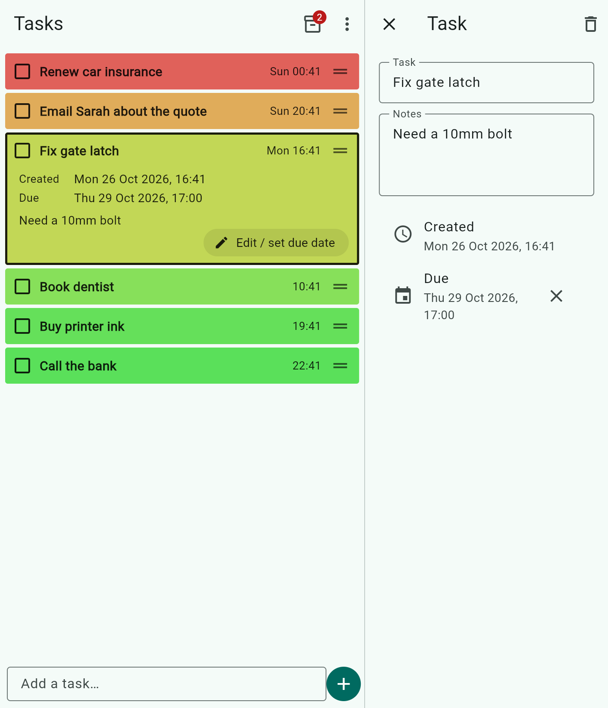

# Improvement plan

Running list of changes from Jeff's feedback. Status: ☐ planned · ◐ in progress · ☑ done

## 1. Use the unfolded Samsung Fold screen sensibly ☑ (PR #1, merged 2026-10-28)

**Feedback:** On the Fold's inner screen the single full-width list wastes space.

**Approach (chosen by Jeff 2026-10-27; PR #1):** when the screen is wide (unfolded Fold, tablet, or a
wide Windows window) switch to two side-by-side panes:

- **Left:** the task list, exactly as now (colour blocks, drag to reorder, tick off).
- **Right:** the task you tapped, opened for editing in place (name, notes, created, due date),
  so there's no jumping to a separate page. With nothing selected, the right pane shows the archive.

Folded (cover screen) looks as it does today; "Edit / set due date" opens the task full screen,
and back/✕ returns to the list. Folding or unfolding keeps the open task. Two panes kick in at
600 dp wide, so the Fold's inner screen gets them in portrait and landscape.

Alternatives considered: a two-column grid of blocks (breaks the "blocks stretch across the
screen" design), or simply larger text/blocks (doesn't use the extra space for anything useful).

## 2. Updates install over the previous version ☑ (PR #1, merged 2026-10-28)

Every CI build used a throwaway debug key, so Android refused to update the installed app.
Release builds are now signed with one permanent key held in the repo's Actions secrets
(`ANDROID_KEYSTORE_BASE64`, `ANDROID_KEYSTORE_PASSWORD`), and each build gets a rising build
number. Without the secrets CI still builds, with a warning. A one-time uninstall is needed
when moving to the new key.

## 3. Safer Dropbox sync ☑ (PR #1, merged 2026-10-28)

Previously the newest whole file won, so edits made on two devices between syncs could be
lost. Now each task carries its own "last changed" time and the two copies are merged task
by task; deletions are remembered for 90 days so they don't come back; list order comes from
whichever device last reordered; settings from whichever last changed them.

## 4. Due date reminders ☑ (PR #1, merged 2026-10-28)

Android shows a notification when an open task reaches its due time (may be a few minutes
late, as Android batches alarms to save battery). Reminders are rebuilt after every change and
sync, so a due date set on the PC reminds you on the phone.

## 5. Swipe gestures ☑ (PR #1, merged 2026-10-28)

Swipe a block right to tick it off, left to delete it. Both show an Undo.

## 6. Colour by due date ☑ (PR #1, merged 2026-10-28)

Settings toggle (on by default): a task with a due date goes green → red between when it was
created and when it's due, instead of at the colour-speed setting.

## 7. Archive search and clean-up ☑ (PR #1, merged 2026-10-28)

Search box in the archive (matches name and notes). Settings → "Delete archived tasks after":
Never (default), 1, 3, 6 or 12 months.

---

# Round 2 ☑ (PR #2, merged 2026-10-28)

## 8. Categories ☑ (PR #2, merged 2026-10-28)

- Each task can be given a category (e.g. Home, Work, Shopping). Categories are created and renamed in Settings.
- **Grouped view** (turned on in Settings): a category heading, then that category's tasks, then the next heading,
  and so on. When it's off, the list looks as it does today.
- Tasks with no category sit in their own group at the top (or bottom).
- Headings are plain bold text (no per-category colours) and can be collapsed to hide their tasks.
- The CSV export gets a Category column.

## 9. Drag between categories ☑ (PR #2, merged 2026-10-28)

- In grouped view, dragging a task under a different heading moves it into that category as well as
  changing its order. Headings can also be dragged to reorder the categories.

## 10. Repeating tasks ☑ (PR #2, merged 2026-10-28)

- In the task, choose a repeat: daily, weekly (pick days), monthly, yearly, or every N days.
- *Proposed:* when a repeating task is ticked off, it goes to the archive as normal and a fresh copy appears
  with the next due date (and its colour starts green again).
- Both modes, chosen per task: **fixed schedule** (next due date counts from the previous due date) or
  **after completion** (counts from when it was ticked off, e.g. "water plants 7 days after last time").

## 11. Text details ☑ (PR #2, merged 2026-10-28)

- Keep the current Notes box. When a task has notes, the thin block shows a short one-line preview
  under the name (blocks without notes stay as thin as now).

## 12. Linked tasks (one after another) ☑ (PR #2, merged 2026-10-28)

- In a task, choose "Comes after…" another task. The later task stays hidden (or shown greyed with a 🔒)
  until the earlier one is ticked off, then appears and starts green.
- Shown greyed out with a 🔒 (so its details can still be edited); it becomes a normal task, starting
  green, when the earlier one is ticked off.

## 13. Focus filter on the main screen ☑ (PR #2, merged 2026-10-28)

- Settings option: show only tasks with no due date or due in the next 30 days (overdue always show);
  tasks due later are tucked away behind a "Later (n)" link.

## 14. Quick dates while typing ☑ (PR #2, merged 2026-10-28)

Typing "Call bank tomorrow 5pm", "Fri", "next week" or "25 Dec" in the add box sets the due date and
strips the words from the name (shown as a hint before you press +).

## 15. Earlier reminders ☑ (PR #2, merged 2026-10-28)

Per task (with a default in Settings): remind at the due time and optionally 1 hour / 1 day / 1 week before.

## 16. Priority star ☑ (PR #2, merged 2026-10-28)

Star a task to keep it at the top of its category/list regardless of colour.

## 17. Snooze ☑ (PR #2, merged 2026-10-28)

Hide a task until a chosen date ("Snooze until…"); it reappears then. Snoozed tasks are listed behind a
"Snoozed (n)" link.

## 18. Home screen widget (Android) ☑ (PR #2, merged 2026-10-28)

The app offers several widgets in Android's widget picker; add any of them, as many times as you like:

- **Task list:** scrolling coloured blocks in list order, with tick boxes (archive without opening the app)
  and a + button that opens straight to typing.
- **Compact:** count of open / overdue tasks and the next 3 due.
- **Quick add:** a single + icon.

When placing a list or compact widget you choose what it shows (all tasks, due soon, or one category),
so e.g. a "Work" widget and a "Home" widget can sit side by side.

## 19. CSV import ☑ (PR #2, merged 2026-10-28)

Import tasks from a CSV in the same format as the export (adds them; doesn't replace the list).

---

# Round 3 ☑ (PR #3, merged 2026-10-28)

## 20. Statistics page ☑ (PR #3, merged 2026-10-28)

A **Statistics** page (from the ⋮ menu) to see how things are going:

- **Done per week**: a bar chart of tasks ticked off over the last 12 weeks, with this week highlighted.
- **On time**: the share of tasks with a due date that were ticked off before it.
- **Typical time to finish**: the median time from adding a task to ticking it off.
- **Open now**: open and overdue counts, and how the open count has moved over the last 30 days.
- **By category**: done and open per category.
- **Streak**: days in a row with at least one task ticked off.
- A period picker: last 7 days, 30 days, 12 months, all time.

Archive clean-up deletes old tasks, so the app keeps a small daily tally (done, on time, by category) that
survives clean-up and syncs through Dropbox. Stats count from when tasks were first archived, so history from
before this update comes from the archive as it is now.

## 21. Tasks from calendar events ☑ (PR #3, merged 2026-10-28)

Look at upcoming calendar events and offer to make tasks from them:

- An **Upcoming events** page (next 14 days) lists events from the calendars you pick; each has **+ Task**,
  which creates a task named after the event, due at its start time (or a set time before, e.g. a day before
  for "prepare for…"). Events already turned into tasks show a tick.
- Nothing pops up unless you choose to. Settings → **Event suggestions**: Off (only when you open the page,
  the default), Once a day, or Once a week. When on, a single dismissible "3 events coming up" line shows at
  the top of the list; events you dismiss or turn into tasks aren't suggested again.
- **Phone only** (agreed 2026-10-28): reads the phone's calendars (Google, Samsung, Outlook accounts added to
  the phone) with permission; nothing leaves the phone. Tasks made from events sync to Windows through Dropbox.

## 22. Calendar view of tasks ☑ (PR #3, merged 2026-10-28)

A month grid (switch from the list with a calendar icon):

- Each day shows coloured dots for tasks due that day (same green→red colours), overdue days marked.
- Tap a day to see its tasks below the grid; tap one to open it. Drag a task onto another day to move its due date.
- Repeating tasks show their future dates faded.
- Undated tasks aren't shown (they stay in the list).
- On the unfolded Fold: month on the left, the chosen day's tasks on the right. A week view as a second option.

## 23. Reusable subtasks (checklists) ☑ (PR #3, merged 2026-10-28)

- Any task can have a **checklist** of steps. Thin blocks show progress like "2/5".
- Tick steps in the expanded block or the task page; reorder by dragging.
- **Reusable**: save a checklist as a **template** (e.g. "Packing for a trip", "Monthly bills") and add it to
  any task in one tap. Templates are managed in Settings.
- Repeating tasks start each repeat with the steps unticked.
- Ticking the last step offers to tick off the whole task.
- Steps have no dates (agreed 2026-10-28). When a step needs one, **Make into task** turns it into a full task
  (which can then have a due date, notes, category and so on). The step stays in the checklist with a link icon,
  opens that task when tapped, and ticks itself when that task is ticked off.
- CSV export lists steps in a column.

## 24. Widget additions (Android) ☑ (PR #3, merged 2026-10-28)

Jeff asked for all of these (2026-10-28).

New widgets, chosen in Android's widget picker like the existing three:

1. **Today:** overdue tasks, tasks due today, and today's calendar events (uses item 21's calendar access).
2. **Focus:** one large block for the top starred task (or the next due), with a tick button.
3. **Checklist:** the steps of one chosen task (item 23), tickable from the home screen.
4. **Stats:** done this week and the current streak (item 20).
5. **Mini month:** a small month calendar with dots on days with tasks due (item 22); tap a day to open it.

Changes to the existing widgets:

6. **More filters:** starred only, overdue only, and a category combined with "due soon".
7. **Look per widget:** light, dark or see-through background; normal or compact rows. Chosen when placing,
   changeable later (long-press → reconfigure).
8. **Snooze button** on each list widget row next to the tick box (snooze until tomorrow 8am; change it in the app).
9. **Quick add into a category:** the quick add widget can be tied to a category (e.g. "Shopping +"), and offers
   voice entry as well as typing.
10. **Fresher colours:** widget colours update more often than every 30 minutes, within Android's battery limits.

## 25. Automatic category for new tasks ☑ (PR #3, merged 2026-10-28)

When a task is added without a category, the app suggests one. It all happens on the device, so there are no
accounts, costs or internet needed:

- **Learns from you:** it looks at the words in tasks you've already put in each category (e.g. "milk",
  "bread" → Shopping) and picks the best match. Every time you move a task to another category, it learns from that.
- **Your own rules:** Settings → Categories → each category can list keywords that always win
  (e.g. "invoice, client, meeting" → Work).
- **Type it:** "#work" or "#shopping" in the task text sets the category directly (and is removed from the title).
- **Where it was added:** a task added from a category's widget, or under a heading in the grouped view, goes into that category.
- The suggestion shows as a chip beside the date chip while you type; tap ✕ to drop it or tap it to choose another.
- Settings → **Auto category:** Off, Suggest (default, shows the chip), or Apply automatically.

## 26. More ways to add tasks ☑ (PR #3, merged 2026-10-28)

Jeff picked these five (2026-10-28):

1. **Share to Task Blocks** (Android): appears in the share sheet of any app. Shared text becomes the title
   (first line) and notes; a shared link goes into the notes. Opens a small add box with the date and category chips.
2. **Paste a list** (both): pasting several lines into the add box offers "Add 6 tasks?", one per line,
   each with its own quick date and category. Bullet marks and numbering are removed.
3. **"Hey Google, add a task…"** (Android): voice entry through Google Assistant, so it works without opening the app.
4. **Photo of a list** (Android): take or pick a photo of a handwritten list or whiteboard. On-device text
   recognition reads it (nothing uploaded), then shows the lines with ticks to choose which become tasks.
5. **Dropbox inbox** (both): any line written to /inbox.txt in the app's Dropbox folder becomes a task on the
   next sync, then the file is cleared. Works with email-to-Dropbox, IFTTT, Zapier and similar services.

Not wanted: missed calls, Windows shortcut key. Notification suggestions: see item 28 (placeholder only).

## 27. Overdue notifications ☑ (PR #3, merged 2026-10-28)

Today the phone gives one reminder at the due time (and an optional earlier one). New option,
Settings → **Overdue reminders**:

- **Off** (as now).
- **Daily summary** at a time you choose (e.g. 8am): "3 tasks overdue: Pay council tax, …". Tap to open the list.
- **Keep nudging**: a reminder for each overdue task every 1, 3 or 6 hours (your choice) until it's done or snoozed.
- **Quiet hours** (e.g. 10pm–7am) when no overdue reminders are sent.
- All task reminders gain **Done** and **Snooze** buttons (1 hour, this evening, tomorrow) so you can deal with
  them from the notification without opening the app.

## 28. Notification suggestions: settings placeholder only ☑ (PR #3, merged 2026-10-28)

Jeff wants to consider this later (2026-10-28). Round 3 adds only the **settings, greyed out and marked
"Coming later"**, with no notification access and no listener code:

- Settings → **Suggestions from notifications**: an on/off switch (disabled).
- **Apps to watch**: a list (disabled).
- **Look for**: dates and times, and words like "appointment, due, deliver, renew, pay" (disabled, editable list shown).
- **Where suggestions go**: the same Suggestions list as calendar events.

If it's built later: Android "Notification access", only from the chosen apps, suggestions only (never added on
their own), everything stays on the phone.

## 29. Clean-up and speed review ☑ (PR #3, merged 2026-10-28)

Jeff asked for a final review before round 3 was built. Done in the same PR:

- **Saving is debounced**: typing in a task used to rewrite the whole file, reschedule every reminder
  and redraw the widgets on every key. Now the screen updates at once and the rest happens 0.4 s
  after you stop typing (and straight away when the app goes to the background).
- **Safer saves**: the file is written to a temporary name and renamed, so a crash mid-write can't
  corrupt the list.
- **Lighter redraws**: the add box is its own widget, so typing no longer rebuilds the whole list.
- **Fewer syncs**: coming back to the app syncs at most once every 30 s.
- **Widgets** parse the shared data once per redraw instead of once per row.
- **CI** now runs `flutter analyze` as well as the tests, and caches the Flutter SDK.
- Removed template leftovers (unused cupertino_icons, TODO comments in Gradle); app version 1.3.0.

# Round 4 ☐

Jeff's feedback on round 3 (2026-10-28). Items 31 and 32 are bugs; items from 30 on are the feature list,
to be agreed before building.

## 30. Where tasks came from, in Statistics ☐

**Feedback:** "Would be good to show where a task was created from in statistics."

Each task remembers how it was added: typed in the app, home screen widget, voice (widget microphone or
"Hey Google"), shared from another app, pasted list, photo of a list, Dropbox inbox file, calendar event,
CSV import, a repeat of an earlier task, or a checklist step made into a task. Statistics gets a
**By source** section: added and done per source for the chosen period, and the share that got done.
The daily tally that survives archive clean-up records the source too, and it syncs through Dropbox.
Tasks from before this update show as "Unknown".

## 31. Reminder and category text squashed in the right-hand pane ◐ (PR #4)

**Feedback:** on the unfolded screen the task pane shows the reminder text vertically, one letter per line.

The "Remind me" and "Category" drop-downs sat at the right edge of their rows; in the narrower right pane
they were squeezed until the text wrapped letter by letter. They now sit under the row's title and take the
full width, with long names cut with "…" instead of wrapping.

## 32. Widget blank for a while after folding ◐ (PR #4)

**Feedback:** after folding the phone the widget disappears, then comes back after a while.

When the launcher resizes a widget (folding changes the grid) it asks the app to redraw; the widgets did
nothing on that request, so the list stayed empty until the next scheduled refresh (up to 15 minutes).
Each widget now redraws itself straight away when its size changes. If this still leaves a gap of a few
seconds, that is the phone restarting the app's widget service and can't be avoided.
